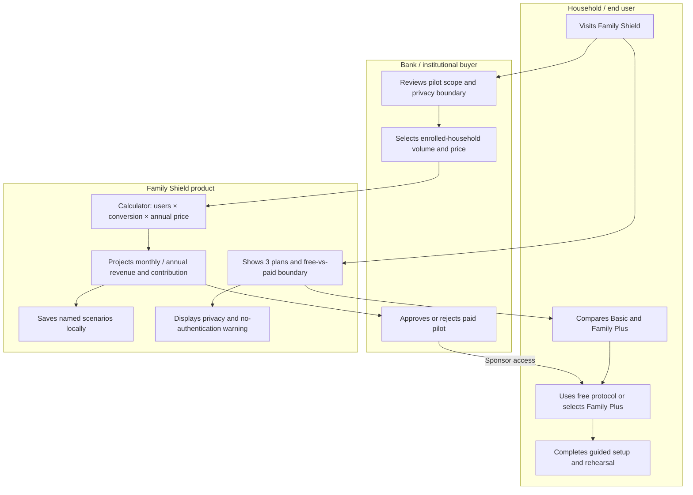

# FAMILY SHIELD — WEEK 14 PACKET
**Course:** Brain Bending · Business Bending Week 14 — Pricing: The Number That Tells the Truth  
**Owner:** Regina Cucchia Villalobos · **Role:** MONEY  
**Venture:** Family Shield / Family Rehearsal  
**Status:** Packet-first build plan. Prices and costs are hypotheses; no bank commitment or real buyer interview is claimed.

## 1. Problem in my words
A Mexican parent receives an urgent call that sounds like an adult child (18–25) who lives elsewhere and asks for money. Under pressure, a familiar voice, caller ID, or emotional story can trigger an immediate transfer. Family Shield helps a household prepare and rehearse a short independent-check routine before an emergency: pause, call the relative using a number already saved, then try two trusted contacts in order. The product sells preparedness and rehearsal, not detection or certainty.

## 2. Exact user, buyer, and payer
- **End user:** Mexican parent, initially about 45–65, whose adult child (18–25) lives elsewhere and could be impersonated in an urgent money request.
- **Secondary user:** the adult child and two trusted contacts who agree on the family protocol in advance.
- **Primary payer hypothesis:** a bank or financial institution sponsoring access as a customer-protection benefit (B2B2C).
- **Secondary payer hypothesis:** a household buying Family Plus directly (D2C).
- **Important distinction:** a bank is the preferred buyer to test, not a confirmed customer. No willingness-to-pay result has been collected.

## 3. Success definition
Before the module closes, the live `/pricing` route works on mobile and desktop and lets a user:
1. Compare three clear plans across two payer segments (households and institutions).
2. Change eligible households/users, conversion or enrollment rate, and annual price.
3. See paying/enrolled households, monthly revenue equivalent, annual gross revenue, variable cost, and contribution, with assumptions visible.
4. Save, reload, compare, and delete at least three named scenarios in the browser.
5. Understand that the free tier preserves the essential safety protocol and that payment buys setup, rehearsal, convenience, or distribution—not caller verification.
6. See the same safety boundary on every plan.

Commercial success is not assumed: the $120 institutional price, $199 Family Plus price, $24 variable cost, and 10:1 value hurdle remain hypotheses pending a real buyer conversation and measured pilot.

## 4. Image-generated mockup
The image-generated Week 14 pricing mockup is stored at `public/week14-pricing-mockup.png`. It is a visual direction reference, not a claim that every displayed value has been validated. The working calculator must use internally consistent assumptions and labels.

## 5. Feature flow — Mermaid swimlane

## 6. Benchmark line — global to Mexico
**The strongest comparable trust-channel benchmark is CommBank CallerCheck (Australia):** it uses a bank-controlled in-app prompt to help customers verify a call claiming to come from the bank. Family Shield cannot copy its authentication function because it does not control a family member's identity channel. It can localize the institutional distribution idea while keeping the family’s verification independent and user-controlled. **Take Five to Stop Fraud (UK)** contributes the simple pause-before-action behavior, and **U.S. FTC guidance** contributes the known-number callback plus second-contact fallback. Mexico localization is Spanish-first, mobile-light, printable, accessible to people with lower digital confidence, and designed around two trusted contacts; it does not depend on WhatsApp or one person answering.

## 7. Long view — three years
If this slice works, Family Shield could become a lightweight family-preparedness service distributed directly and through trusted institutions. Households could configure their contact order and rehearse the protocol periodically, while institutions receive only aggregate, non-identifying adoption metrics. The product remains a preparedness and coordination layer—not a deepfake detector, identity authority, emergency service, or payment controller.

## 8. Scope cut
- No voice, video, face, or deepfake detection.
- No caller-authenticity verdict, “safe” badge, emergency guarantee, or guarantee against fraud.
- No payment initiation, payment blocking, automatic hold, or access to bank accounts.
- No access to phone contacts, call recordings, WhatsApp, messages, security phrases, or family communications.
- No personally identifiable family information or raw rehearsal data shared with an institution.
- No custom bank integration, human call center, or manual family onboarding in this slice.
- No backend database or authentication because the pricing calculator stores only named scenario assumptions locally in the user's browser. No personal data is requested or stored.

## 9. Architecture + stack
| Layer | Choice | Reason |
|---|---|---|
| Framework | Existing Next.js 15.5.28 | Continue the Week 13 codebase |
| UI | React 19.1.2 + TypeScript | Interactive pricing calculator and scenarios |
| Styling | CSS | Responsive, accessible, consistent with existing app |
| Hosting | Vercel | Existing production hosting; deploy preview then production |
| Source | GitHub `reginabuilds/family-rehearsal` | Existing venture repository |
| Scenario persistence | Browser localStorage | Save scenario inputs only on the user's device |
| Database / auth | None | No personal data is collected; no Supabase table needed |
| Secrets | None | No API keys or secrets required |

## 10. Pricing decision and assumptions
| Tier | Segment | Price | Included |
|---|---|---:|---|
| Basic Household | Household / end user | Free | Essential pause–call-back–two-trusted-contacts protocol and one basic rehearsal |
| Family Plus | Household / direct payer | $199 MXN per household/year | Guided setup, repeat rehearsals, printable family instructions, accessible reminders |
| Institutional | Bank / financial institution | $120 MXN per enrolled household/year | Sponsored access, agreed pilot scope, aggregate non-identifying engagement reporting; proposed 500-household minimum |

The institutional unit price is lower because the buyer aggregates households and distribution, reducing acquisition friction. Custom integration, legal review, or human support is not included and would require separate costing.

### Unit economics — institutional opening hypothesis
- Price: **$120 MXN / enrolled household / year**
- Variable delivery and support allowance: **$24 MXN / household / year** (assumption, not measured)
- Contribution: **$96 MXN / household / year**
- Contribution margin: **80%**, before fixed engineering, sales, compliance, and administration costs
- 500 enrolled households: **$60,000 annual gross revenue**, **$12,000 variable cost**, **$48,000 contribution** (not net profit)
- Sensitivity: at $60 variable cost, contribution falls to $60 (50%); at $120 variable cost, contribution is zero before fixed costs.

### The 10:1 memo — deliberately adversarial
At $120 per household/year, a 10:1 benefit-to-price hurdle requires **$1,200 MXN of measurable annual value per enrolled household** to the payer. This is not established by the possible loss from one scam, national fraud totals, or fear. The bank must identify an attributable value pool, such as reduced support workload for relevant incidents, and show its calculation and allocation method. If the bank cannot substantiate $1,200 per household, the 10:1 claim fails; we lower/restructure the price, change payer, or reject the model. Pilot measurement must include onboarding time, successful activation, ability to execute the protocol after one week, relevant support contacts, and cost per activated household.

## 11. Pricing calculator logic and saved scenarios
- Direct-to-consumer: `paying households = eligible users × conversion rate`; `annual gross = paying households × annual price`; `monthly equivalent = annual gross ÷ 12`.
- Institutional: `enrolled households = eligible households × enrollment rate`; `annual gross = enrolled households × price per household/year`; `monthly equivalent = annual gross ÷ 12`.
- `variable cost = paying/enrolled households × variable cost per household`; `contribution = annual gross − variable cost`.
- Scenario assumptions are visible and editable. Scenarios are saved locally; they are not transmitted to a server.
- The 500-household example is explicitly 500 **enrolled** households at 100% enrollment of the 500-household pilot cohort, not 500 visitors at 1% conversion.

## 12. Real payer conversation — required, not fabricated
**Status: NOT YET COMPLETED.** Target a decision-maker in fraud prevention, customer experience, financial education, digital banking, or customer protection—not a teller. Ask:  
“Would your institution pay $120 MXN per enrolled household per year for a 500-household Family Shield pilot? If not, what evidence, price, budget owner, and procurement conditions would make it viable?”  
Record date, role (not personal details), exact answer, objection, budget owner, procurement path, privacy requirements, and next step. Do not write a hypothetical response as evidence.

## 13. Security floor
1. No secrets or API keys in code or repo.
2. No personal data is collected; therefore no personal-data account or database is introduced.
3. No Supabase tables exist; RLS is not applicable to this client-only prototype.
4. Every numeric input has type/range validation and sensible bounds; scenario names have length limits.
5. Only invented sample data is used. No real family contacts, phone numbers, phrases, messages, or recordings appear in demos.
6. Institutional reporting is aggregate only. No family contact graph, vulnerability score, or raw rehearsal data is shared.
7. Every tier repeats: “Family Shield does not verify who is calling. Pause and independently contact your relative using a number you already know.”

## 14. Test plan
**Mechanical pass:** test the /pricing route; validate minimum/maximum numeric inputs; test 0%, 1%, and 100% conversion; verify the $199 D2C example; verify 500 enrolled × $120 = $60,000 annual; verify $12,000 variable cost and $48,000 contribution at $24 cost; save/reload/compare/delete scenarios; test empty/long scenario names; test mobile width and keyboard focus. Log at least one actual bug, fix it, and redeploy—do not invent a bug before running the app.

**Layer 1 synthetic persona:** Doña Mari, 54, sells food outside a metro station, uses WhatsApp but distrusts unfamiliar apps, reads slowly, and gives up silently when confused. Walk her through screenshots of pricing and the calculator; ask where she hesitates, what she thinks the plans promise, whether she understands the free/paid boundary, and whether the calculator makes sense. Log every confusion and fix the worst one. This is a synthetic test, not a real user interview.

**Buyer test:** separately test the payer hypothesis with one qualified institutional decision-maker. A favorable reaction is not a purchase; record actual willingness to pay, budget owner, procurement path, privacy objections, and measurable-value requirement.

**Acceptance criteria:** all arithmetic reconciles; scenarios persist locally; no false security promise; the $120 price is marked provisional; no fabricated interview or test results.

## References
1. CommBank CallerCheck: https://www.commbank.com.au/support/security/callercheck.html
2. Take Five to Stop Fraud: https://www.takefive-stopfraud.org.uk/about/about-us/
3. U.S. FTC, AI voice-cloning family emergency scams: https://consumer.ftc.gov/consumer-alerts/2023/03/scammers-use-ai-enhance-their-family-emergency-schemes
4. CONDUSEF, Comunicado 081 (28 May 2026): https://www.condusef.gob.mx/documentos/prensa/Comunicado%20081.pdf

**Evidence boundary:** price, variable cost, conversion, and 10:1 value are assumptions for testing. No real buyer commitment, pilot outcome, or fraud reduction is claimed.

---
# WEEK 15 ADDENDUM — DISTRIBUTION
**Owner:** Regina Cucchia Villalobos · **Role:** USER  
**Status:** Strategy and assets prepared; real audience test and demo recording pending.

## 15. Audience, need, moment
Primary audience: Mexican parents/caregivers, initially 45–65, coordinating with an adult child living elsewhere. The critical user receives an urgent call or voice note that appears to come from a relative and requests money. Secondary audience: adult children and trusted relatives who agree on a contact sequence before a crisis. The payer remains unvalidated: household D2C and institutional sponsorship are hypotheses, not customers.

## 16. Positioning and promise
Family Shield is a family preparedness guide that helps users pause and check an urgent money request through a separate, known channel. Promise: “Pausa antes de pagar. Comprueba por otro medio.” Never promise cloned-voice detection, caller authentication, certainty that an emergency is real, prevention of every scam, or payment authorization. The prototype guides the user; it does not call, access contacts, verify identity, or control money.

## 17. Existing evidence and its limits
The working Spanish-language prototype shows pause → call saved family number → trusted contact 1 → trusted contact 2 → keep the pause if unconfirmed. This proves that the guided flow exists, not that it reduces fraud or that users understand it. The prior persona walkthrough is synthetic. No Week 15 audience views, clicks, shares, signups, or conversion results are claimed.

## 18. Brand system
Three voice rules: calm/non-alarmist; direct everyday Mexican Spanish; transparent about limits. Weak line: “Detecta si una voz es falsa con IA.” Rewritten: “Si una llamada te pide dinero con urgencia, haz una pausa y comprueba por otro medio.” Palette: forest green #1E3A2F, warm ivory #F7F7F1, sage #EAF1EB, ochre #C58B43, ink #26352D. Typography: Georgia/serif headline + DM Sans/Arial body. Repeatable layout: logo/series → one headline → 1–3 actions → visible limitation → one CTA.

## 19. Six concepts across three series
- A · Reconoce el riesgo: “Una voz conocida no es una verificación”; “La urgencia es una razón para pausar.”
- B · Actúa en el momento: “Pausa antes de pagar”; “Si no contesta, ¿qué sigue?” Show family → contact 1 → contact 2 → pause.
- C · Prepara a tu familia: “Acuerden hoy dos contactos de confianza”; “Practiquen el plan en cinco minutos.”
Three finished asset scripts/copy are in docs/WEEK15_PLAYBOOK.md: six-frame carousel, 30-second Reel, and WhatsApp checklist.

## 20. Creative production method
Research: audience problem + sources → fact sheet; check source/date and no invented stats. Writing: fact sheet + audience + goal → Spanish copy; check clear action/no fear bait. Visual production: approved copy + brand system → carousel/video/checklist; check legibility, contrast, captions, mobile format. Evidence/claim check: final claims → claim ledger; verify every factual claim and show limitations. Style review: draft asset → brand-consistent asset; check three voice rules. Revision: real test observations → revised asset; check that confusion is reproduced and corrected. Human approval is mandatory before publication.

## 21. Distribution test plan
Primary channel: WhatsApp family sharing; secondary: Instagram carousel and Reel. Test Asset 1 carousel and Asset 2 Reel with five target users, ideally parents/caregivers 45–65 and adult children; recruit at least three strangers where feasible. Show each asset without explanation. Ask what they would do, which number they would call, what happens if nobody answers, what the product can/cannot do, and whether they would share it. Record participant codes only, consent, comprehension, hesitation, and voluntary next action. A mistaken belief that the app verifies callers is a stop-and-revise finding.

## 22. Honest results
NOT YET TESTED WITH A REAL AUDIENCE. No reach, click, signup, share, or conversion numbers are claimed. Use docs/WEEK15_TEST_LOG_TEMPLATE.md to record actual results. Zero response is valid evidence.

## 23. Deployment and demo
Existing protocol: https://family-rehearsal.vercel.app  
Campaign page after successful deployment: https://family-rehearsal.vercel.app/distribution  
The campaign page links to the protocol and does not collect personal data. Demo script: docs/DEMO_WEEK15_SCRIPT.md.

## 24. Open evidence
Pending: two-asset test with five real target users; live mechanical browser pass; 3:30 screen recording; full original build conversation export. Existing repository history already has more than five commits and multiple READY production deployments; preserve the real history rather than creating artificial commits.
